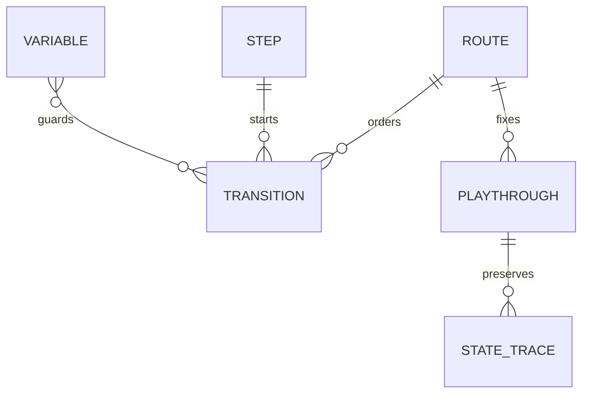

# 领域与本体设计

## 专业聚合

Evidence固定依据、Variable状态变量、Step任务阶段、Transition条件转移、Route固定路线、Playthrough试玩快照、Note意见。根字段：evidence、variables、steps、transitions、routes、playthroughs、notes、basis_refs。专业对象以WorkRef＋owner_plugin_id＋object_id确定身份，revision＋sha256固定内容。相同标题不代表同一对象。

变量为有界整数或0／1标记，条件与效果引用明确变量；重复效果、越界初值和悬空引用拒绝。转移先核验当前阶段和全部守卫，再原子应用效果；循环允许但试玩和状态搜索有界。路线固定变量、阶段和转移组合摘要，改条件后旧路线不能当当前试玩。试玩记录保存完整专业快照与程序计算的轨迹，旧记录不覆盖，不能提交伪造状态。状态搜索达到预算返回无法判断，不把未搜到当不可达。

所有集合ID唯一、所有引用存在、集合有界、顺序在对应父级唯一。撤销先处理依赖，不能制造悬空引用；来源索引只追加，整本保存不能改变原索引意义。跨包引用只携带固定Owner、对象、修订与摘要，通过公开SDK回读，不导入对方私有结构。

## 权属

原始资料、作品身份与受管事务归Core；专业记录归本包；理解、创作与解释归作者选择的外部Agent；表达取舍与定稿归作者。借助欧卡姆原理复用通用事实，只增加本旅程需要的专业状态。
